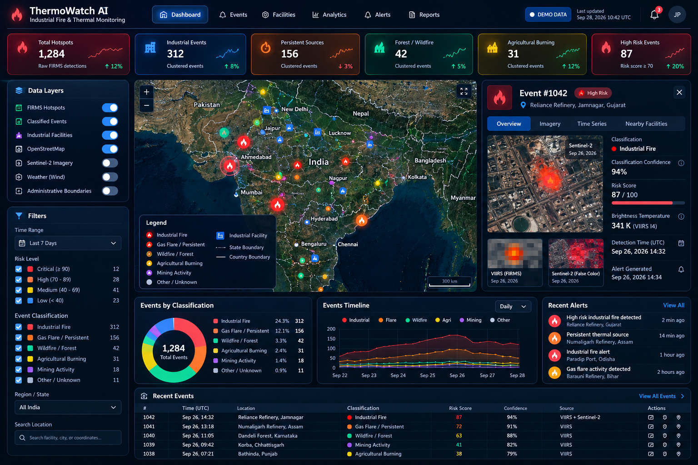
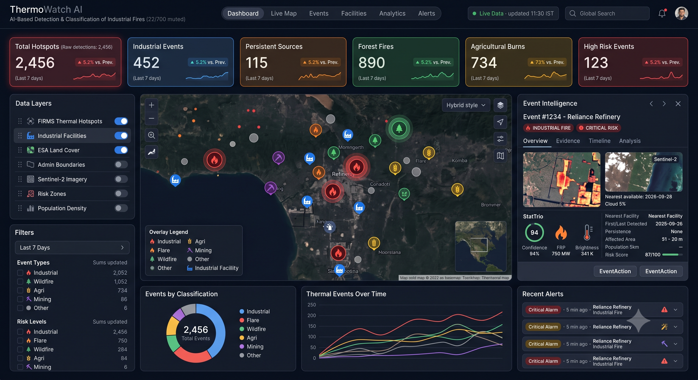
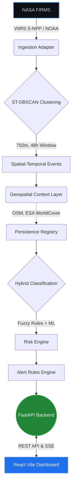
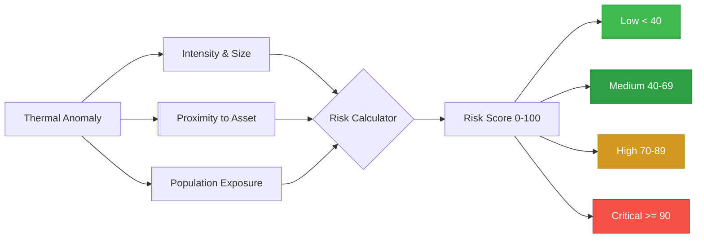
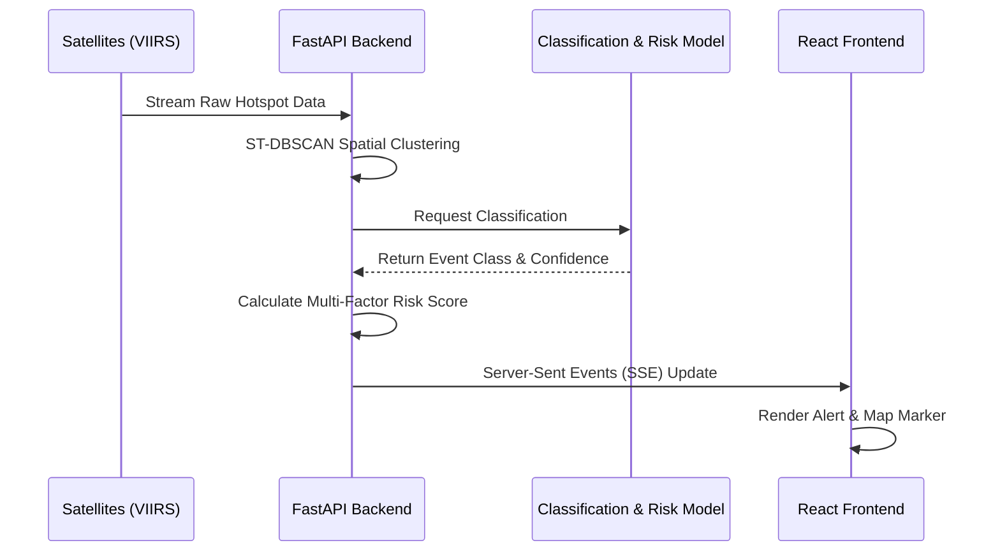

# 🔥 ThermoWatch AI — PS 26162

<div align="center">
  <h3>AI-Based Detection and Classification of Industrial Fires and Persistent Thermal Sources</h3>
  <p><strong>Smart India Hackathon</strong> · NASA FIRMS + OpenStreetMap + Sentinel-2 Multispectral Analysis</p>

  <p align="center">
    <a href="#features"></a>
    <a href="#architecture"></a>
    <a href="#quick-start"></a>
  </p>
</div>

---

## 📸 Dashboard Interface

<p align="center">
  
  &nbsp;
  
</p>

<p align="center">
  <br/>
  <i>Developed for the Smart India Hackathon</i><br/><br/>
  
</p>

---

## 📖 Overview

**ThermoWatch AI** is a state-of-the-art intelligent monitoring system designed to address the critical challenge of detecting, classifying, and mitigating industrial fires, agricultural burning, and other persistent thermal anomalies using real-time satellite data. 

By integrating multi-source satellite intelligence (NASA FIRMS, Sentinel-2) with advanced spatial-temporal clustering (ST-DBSCAN) and contextual data (OpenStreetMap), ThermoWatch provides an authoritative, deterministic risk assessment in real-time.

---

## 🏗 System Architecture

ThermoWatch AI employs a highly scalable, decoupled architecture combining a high-performance **FastAPI** Python backend with a reactive **React 18** frontend.

### 🔹 Core Architecture Diagram


### 🔹 Risk Evaluation Flowchart
Risk scoring is deterministic and factors in anomaly intensity, human exposure, and proximity to critical industrial assets.



### 🔹 Real-Time Data Pipeline Sequence


---

## ✨ Features Implemented

### 🖥 Frontend Application
- **Master Reference Visual Parity**: Dark navy glassmorphism theme (`#050A12`), translucent panels, borders, neon highlights, and custom Inter typography.
- **Header**: Brand mark, nav pills with route indicator, `DEMO DATA` status chip, global search bar (`⌘K`), notification bell with unread badge, and user avatar.
- **Headline KPI Cards**: Total Hotspots, Industrial Events, Persistent Sources, Forest / Wildfire, Agricultural Burning, High Risk Events with SVG sparklines and deltas.
- **Left Rail**: Data Layer toggles with active status + faceted filters (time range, risk levels, event classes, region select).
- **Central GIS Map**: Interactive Leaflet canvas with satellite/hybrid/dark modes, class-colored markers, pulsing clusters on critical events, legend, and 300 km scale bar.
- **Event Intelligence Panel**: Details including dual Sentinel-2 & VIIRS thermal footprint thumbnails, classification confidence (94%), risk score (87/100), brightness temperature, facts table.
- **Bottom Analytics**: Donut chart, multi-line timeline chart, and recent alerts card.
- **Secondary Pages**: 
  - `/map`, `/events`, `/facilities`, `/analytics`, `/alerts`, `/reports`, `/settings`

### ⚙️ Backend Services
- **FastAPI Core**: High-throughput REST endpoints under `/api/v1` for metadata, KPIs, events, facilities, alerts, and streams.
- **Spatial Processing**: Haversine distance calculations, KNN nearest facility matching, hazard tier weights.
- **Clustering**: ST-DBSCAN algorithm with 750m spatial radius and 48h temporal linking.
- **Rule Engine**: Deterministic R0-R6 rule cascade for classifying fire types (industrial, gas flares, wildfires, agricultural burns, mining).
- **Risk Scoring**: 6-component weighted formula (intensity, anomaly, asset criticality, population exposure, escalation, class severity).
- **Simulation**: Virtual clock replay engine with playback controls.
- **SSE Stream**: Server-Sent Events delivering real-time status and telemetry to the client.

---

## 🚀 Quick Start & Execution Commands

### 1. Frontend Development
```bash
cd frontend
npm install
npm run dev
# Running on http://localhost:5173
```

### 2. Backend Development
```bash
cd backend
python -m venv venv
source venv/bin/activate  # On Windows use `venv\Scripts\activate`
pip install -r requirements.txt
python run.py
# API running on http://localhost:8000
# Docs available at http://localhost:8000/docs
```

### 3. Run Automated Tests
```bash
cd backend
python -m pytest tests/test_backend.py -v
```

### 4. Full Docker Compose Deployment
Ensure Docker is installed and running, then simply execute:
```bash
docker compose up --build
```
*The application will automatically orchestrate all services, binding the frontend to port 5173 and backend to 8000.*

---

<div align="center">
  <p>Built with ❤️ by Team PS 26162</p>
</div>
